# Clearance Check Canary — Layered Architecture & Module Dependencies

**Product:** Clearance Check Canary  
**Version:** v2.0.1-canary.1  
**Author:** Prepared by: Antigravity (AI assistant) — for review by Sounit Karttikay  
**Status:** CANARY FOUNDATION (Evaluation Only — Not for Screening Decisions)  

---

## 1. Architectural Principles

The Clearance Check Canary (v2 line) implements a strict **Hexagonal / Clean Layered Architecture** with unidirectional dependency rules. Reverse imports and layer-skipping imports are forbidden and strictly enforced via automated AST import-linter tests in the CI pipeline (`tests/test_layered_architecture.py`).

### Layer Definitions

```
┌────────────────────────────────────────────────────────┐
│                      INTERFACES                        │
│   HTTP Service API (FastAPI)   │   Desktop Canary UI   │
└───────────────────────────┬────────────────────────────┘
                            │ imports
                            ▼
┌────────────────────────────────────────────────────────┐
│                      APPLICATION                       │
│    Use Cases (Screen, Batch, Ownership, Country, etc.) │
│    Ports (Repository, IdP, IndexProvider, ReportWriter)│
│    Identity & Permissions (5 Roles, Four-Eyes Rule)    │
└───────────────┬────────────────────────────┬───────────┘
                │ implements ports           │ imports
                ▼                            ▼
┌──────────────────────────┐    ┌────────────────────────┐
│         ADAPTERS         │    │         DOMAIN         │
│  SQLite / PostgreSQL     │    │  Matching Engine       │
│  OIDC Client / WinAuth   │    │  Tiering Engine        │
│  PDF & Excel Writers     │    │  50% Ownership / UBO   │
│  Index Providers         │    │  Country Evaluation    │
└──────────────────────────┘    │  Pure Domain Models    │
                                └────────────────────────┘
```

1. **Domain (`canary.domain`):**
   - Contains pure business entities, matching engines, tiering rules, ownership calculation (50% rule, aggregation), and country rules.
   - **Zero I/O:** Absolutely no disk, database, network, subprocess, or external library calls. Pure deterministic in-memory calculations.
   - **Forbidden Imports:** Must NOT import from `application`, `adapters`, or `interfaces`.

2. **Application (`canary.application`):**
   - Coordinates business use cases: `ScreenEntityUseCase`, `BatchScreenUseCase`, `OwnershipCheckUseCase`, `CountryCheckUseCase`, `FullRecordUseCase`, `SourceStatusUseCase`, `ReportsUseCase`, `HealthUseCase`.
   - Defines abstract **Ports** (RepositoryPort, IndexProviderPort, IdpPort, ReportWriterPort).
   - Enforces the 5 enterprise roles (`Screener`, `Reviewer`, `Compliance`, `Administrator`, `Auditor`) and maker-checker four-eyes isolation.
   - **Forbidden Imports:** Must NOT import from `adapters` or `interfaces`.

3. **Adapters (`canary.adapters`):**
   - Implements ports defined by the application layer:
     - `storage`: `SQLiteRepository` (Desktop Canary mode with WAL and append-only triggers) and `PostgreSQLRepository` (Server container mode with permission revocation and append-only trigger DDL).
     - `identity`: `GenericOIDCClient` (JWT verification) and `MockOIDCProvider` for tests, plus `get_windows_fallback_user`.
     - `sources`: `PythonIndexAdapter` candidate retriever.
     - `reports`: `CanaryPDFWriter` and `CanaryExcelWriter` with mandatory Canary header/footer notices.
   - **Forbidden Imports:** Must NOT import from `interfaces`.

4. **Interfaces (`canary.interfaces`):**
   - Delivery mechanisms for external clients:
     - `api`: Versioned HTTP API (`/api/v1/...`) in FastAPI with OpenAPI 3.1.0 specifications, RFC 7807 Problem Details error formatting, rate limiting, and size limiting.
     - `desktop`: Desktop Canary launcher, thin client, and read-only stable data importer.

---

## 2. Module Dependency Matrix

```mermaid
graph TD
    subgraph Interfaces["Interfaces Layer (canary.interfaces)"]
        API["api.routes / api.app<br/>(FastAPI HTTP Endpoints)"]
        Desktop["desktop.launcher / import_stable<br/>(Thin Desktop Client)"]
    end

    subgraph Application["Application Layer (canary.application)"]
        UC_Screen["use_cases.screen_entity"]
        UC_Batch["use_cases.batch_screen"]
        UC_Owner["use_cases.ownership_check"]
        UC_Country["use_cases.country_check"]
        UC_Record["use_cases.full_record"]
        UC_Report["use_cases.reports"]
        Ports["ports (Repository, IdP, Index, Report)"]
        Identity["identity (Roles, Permissions, Four-Eyes)"]
    end

    subgraph Adapters["Adapters Layer (canary.adapters)"]
        Repo_SQLite["storage.sqlite_repo (Append-Only Triggers)"]
        Repo_PG["storage.postgres_repo (App Role Revoke)"]
        OIDC["identity.oidc_client (Mock / Generic OIDC)"]
        WinAuth["identity.windows_auth (Desktop Fallback)"]
        Source_Adapter["sources.index_adapter"]
        Rep_PDF["reports.pdf_writer (Canary Banner)"]
        Rep_Excel["reports.excel_writer (Canary Banner)"]
    end

    subgraph Domain["Domain Layer (canary.domain)"]
        Models["domain.models (Pure Dataclasses)"]
        Matching["domain.matching (Normalizer, Phonetic, Scoring)"]
        Tiering["domain.tiering (Pure Tier Assignment)"]
        Ownership["domain.ownership (50% Rule, Aggregation)"]
        Country["domain.country (FATF, Comprehensive)"]
    end

    API --> UC_Screen
    API --> UC_Batch
    API --> UC_Owner
    API --> UC_Country
    API --> UC_Record
    API --> UC_Report
    Desktop --> API
    Desktop --> Repo_SQLite

    UC_Screen --> Ports
    UC_Screen --> Identity
    UC_Screen --> Tiering
    UC_Screen --> Models

    UC_Owner --> Ports
    UC_Owner --> Identity
    UC_Owner --> Ownership
    UC_Owner --> Models

    UC_Country --> Ports
    UC_Country --> Identity
    UC_Country --> Country
    UC_Country --> Models

    Repo_SQLite -. implements .-> Ports
    Repo_PG -. implements .-> Ports
    OIDC -. implements .-> Ports
    WinAuth -. implements .-> Ports
    Source_Adapter -. implements .-> Ports
    Rep_PDF -. implements .-> Ports
    Rep_Excel -. implements .-> Ports

    Tiering --> Matching
    Tiering --> Models
    Ownership --> Models
    Country --> Models
```



---

## 3. Strict Boundary Rules

| Layer | Can Import From | Cannot Import From |
|---|---|---|
| **`canary.domain`** | Standard Library (Pure math/string/dataclasses) | `application`, `adapters`, `interfaces`, `requests`, `sqlite3`, `io` |
| **`canary.application`** | `canary.domain`, Standard Library | `adapters`, `interfaces`, `fastapi`, `sqlite3` |
| **`canary.adapters`** | `canary.application`, `canary.domain`, external drivers (`sqlite3`, `openpyxl`, `reportlab`) | `interfaces`, `fastapi` routes |
| **`canary.interfaces`** | `canary.application`, `canary.domain`, web framework (`fastapi`, `starlette`) | Direct database modification bypassing use cases |

These boundaries are automatically validated on every commit by `tests/test_layered_architecture.py`.
